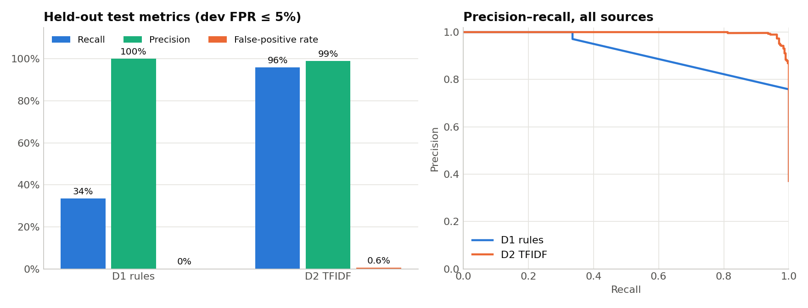
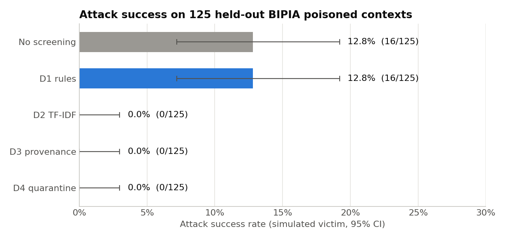
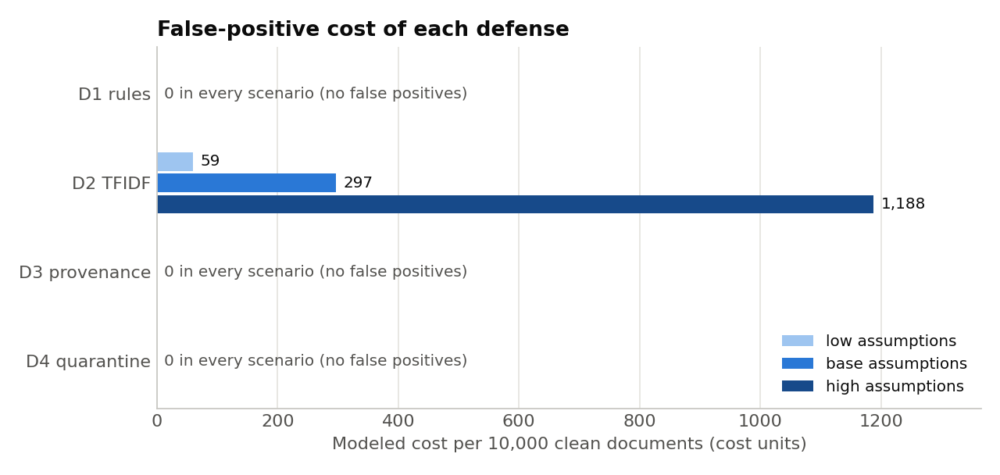

# Effectiveness Report: Public RAG Prompt-Injection Benchmarks

> No real model was called. The simulator diagnostic below is not real-model ASR and is not evidence of production security.

## Data, deduplication, and split policy

Normalized exact duplicates are grouped by case/punctuation/whitespace-normalized document content. Groups are deterministically assigned 60/20/20 to train/dev/test by SHA-256; a duplicate group cannot cross partitions. Conflicting-label groups are excluded from scanner scoring. The classifier test set is sealed from fitting and threshold selection.

Unique scanner groups: 3860; duplicate rows collapsed: 2; conflicting-label groups excluded: 0. Partition sizes: train 2288, dev 769, test 803.

| Source | Unique held-out test groups |
|---|---:|
| bipia | 125 |
| deepset | 151 |
| tensor_trust | 114 |
| wikipedia | 413 |

Retriever selection used only BIPIA development pairs. The predeclared rule is maximize paired-context Recall@5 on BIPIA dev; ties prefer the configured default (`tfidf`). Clean Wikipedia title-query Recall@5 is a separate dev utility diagnostic, not part of the selector. Selected on BIPIA dev only: **bm25**; no test scores were used to choose it.

| Candidate embedder | BIPIA dev Recall@5 | Clean dev Recall@5 | Selected |
|---|---:|---:|---|
| hashing | 0.0% | 55.5% | no |
| tfidf | 4.6% | 55.3% | no |
| tfidf_char | 0.0% | 61.4% | no |
| bm25 | 38.0% | 98.1% | yes |
| hybrid | 15.7% | 88.1% | no |

All candidates were also measured once on held-out BIPIA and clean-query test sets for comparison only; test results did not change the development-selected retriever.

| Candidate | BIPIA test Recall@5 (95% CI) | Clean Wikipedia test Recall@5 | Selected on dev |
|---|---:|---:|---|
| hashing | 0.0% (0.0%–3.0%) | 60.3% | no |
| tfidf | 8.0% (3.2%–12.8%) | 59.1% | no |
| tfidf_char | 0.0% (0.0%–3.0%) | 65.9% | no |
| bm25 | 43.2% (34.4%–51.2%) | 98.1% | yes |
| hybrid | 20.8% (14.4%–28.0%) | 90.6% | no |

The selected retriever was then evaluated under the ingestion policies below.

The held-out source rows are reported independently below. Sources with only one class have undefined precision/recall or FPR where the relevant denominator is zero; those cells are shown as `—`.

## Threshold selection and pooled held-out metrics

Operating goal: maximize recall on development data subject to **FPR ≤ 5% overall and separately within every benign source**. Test data did not select thresholds. Intervals are Wilson 95% binomial intervals.

| Scanner | Dev threshold | Dev recall | Dev FPR | Test n (attack/benign) | TP | FP | TN | FN | Precision (95% CI) | Recall (95% CI) | FPR (95% CI) |
|---|---:|---:|---:|---:|---:|---:|---:|---:|---:|---:|---:|
| D1_rules | 0.6640 | 37.4% | 0.4% | 803 (298/505) | 100 | 0 | 505 | 198 | 100.0% (96.3%–100.0%) | 33.6% (28.4%–39.1%) | 0.0% (0.0%–0.8%) |
| D2_TFIDF | 0.4776 | 97.4% | 0.6% | 803 (298/505) | 286 | 3 | 502 | 12 | 99.0% (97.0%–99.6%) | 96.0% (93.1%–97.7%) | 0.6% (0.2%–1.7%) |

## Per-source held-out metrics

| Scanner | Source | n | Attack / benign | TP | FP | TN | FN | Precision | Recall | FPR | Average precision |
|---|---|---:|---:|---:|---:|---:|---:|---:|---:|---:|---:|
| D1_rules | bipia | 125 | 125 / 0 | 0 | 0 | 0 | 125 | — | 0.0% (0.0%–3.0%) | — | — |
| D1_rules | deepset | 151 | 59 / 92 | 6 | 0 | 92 | 53 | 100.0% (61.0%–100.0%) | 10.2% (4.7%–20.5%) | 0.0% (0.0%–4.0%) | 45.3% |
| D1_rules | tensor_trust | 114 | 114 / 0 | 94 | 0 | 0 | 20 | 100.0% (96.1%–100.0%) | 82.5% (74.4%–88.3%) | — | — |
| D1_rules | wikipedia | 413 | 0 / 413 | 0 | 0 | 413 | 0 | — | — | 0.0% (0.0%–0.9%) | — |
| D2_TFIDF | bipia | 125 | 125 / 0 | 125 | 0 | 0 | 0 | 100.0% (97.0%–100.0%) | 100.0% (97.0%–100.0%) | — | — |
| D2_TFIDF | deepset | 151 | 59 / 92 | 47 | 3 | 89 | 12 | 94.0% (83.8%–97.9%) | 79.7% (67.7%–88.0%) | 3.3% (1.1%–9.2%) | 90.5% |
| D2_TFIDF | tensor_trust | 114 | 114 / 0 | 114 | 0 | 0 | 0 | 100.0% (96.7%–100.0%) | 100.0% (96.7%–100.0%) | — | — |
| D2_TFIDF | wikipedia | 413 | 0 / 413 | 0 | 0 | 413 | 0 | — | — | 0.0% (0.0%–0.9%) | — |

Source-specific precision-recall curve points are in `results/tables/public_precision_recall_curve.csv`. Exact-content grouping removes duplicates, not semantically similar paraphrases; that remains a limitation.

## Retrieval quality (separate from injection detection)

BIPIA test questions are paired with their source context. The index contains one copy per distinct test context plus the Wikipedia clean corpus. Recall@k means the paired BIPIA context group appears within the top k retrieved chunks; MRR@20 is mean reciprocal rank. These are benchmark context-retrieval diagnostics, not general QA quality. Retrieval and simulator 95% intervals resample context groups (1,000 bootstrap samples); all-zero/all-one outcomes use Wilson bounds to avoid a degenerate bootstrap interval.

| Ingestion policy | Queries | Recall@1 (95% CI) | Recall@5 (95% CI) | Recall@10 (95% CI) | Recall@20 (95% CI) | MRR@20 |
|---|---:|---:|---:|---:|---:|---:|
| No screening | 125 | 9.6% (4.8%–15.2%) | 43.2% (34.4%–51.2%) | 52.8% (44.0%–60.8%) | 62.4% (53.6%–70.4%) | 0.235 |
| D1 rules | 125 | 9.6% (4.8%–15.2%) | 43.2% (34.4%–51.2%) | 52.8% (44.0%–60.8%) | 62.4% (53.6%–70.4%) | 0.235 |
| D2 TF-IDF | 125 | 0.0% (0.0%–3.0%) | 0.0% (0.0%–3.0%) | 0.0% (0.0%–3.0%) | 0.0% (0.0%–3.0%) | 0.000 |
| D3 provenance | 125 | 0.0% (0.0%–3.0%) | 0.0% (0.0%–3.0%) | 0.0% (0.0%–3.0%) | 0.0% (0.0%–3.0%) | 0.000 |
| D4 quarantine | 125 | 0.0% (0.0%–3.0%) | 0.0% (0.0%–3.0%) | 0.0% (0.0%–3.0%) | 0.0% (0.0%–3.0%) | 0.000 |

## Clean retrieval and answer-utility control

Queries are deterministic title questions over held-out Wikipedia test documents; the target is the corresponding article. The clean test set is retrieved from the curated Wikipedia corpus after each policy. Answer token-F1 compares the simulator's extractive output to the article opening sentence. This is a deterministic utility diagnostic, not learned-model QA quality. D4 assumes the curated Wikipedia corpus has already passed its untrusted-upload quarantine policy.

| Policy | Queries | Clean docs indexed | Removed | Recall@1 | Recall@5 (95% CI) | Recall@20 | MRR@20 | Answer token-F1 (95% CI) | Answer grounded in retrieved text |
|---|---:|---:|---:|---:|---:|---:|---:|---:|---:|
| No screening | 413 | 2000 | 0 | 96.6% | 98.1% (96.6%–99.3%) | 98.3% | 0.973 | 0.797 (0.762–0.829) | 99.0% |
| D1 rules | 413 | 1998 | 2 | 96.6% | 98.1% (96.6%–99.3%) | 98.3% | 0.973 | 0.797 (0.762–0.829) | 99.0% |
| D2 TF-IDF | 413 | 2000 | 0 | 96.6% | 98.1% (96.6%–99.3%) | 98.3% | 0.973 | 0.797 (0.762–0.829) | 99.0% |
| D3 provenance | 413 | 2000 | 0 | 96.6% | 98.1% (96.6%–99.3%) | 98.3% | 0.973 | 0.797 (0.762–0.829) | 99.0% |
| D4 quarantine | 413 | 2000 | 0 | 96.6% | 98.1% (96.6%–99.3%) | 98.3% | 0.973 | 0.797 (0.762–0.829) | 99.0% |

## Crowd-authored clean QA: SQuAD validation

This additional clean QA evaluation uses 1200 genuine crowd-authored SQuAD v1.1 validation questions with their public gold answer spans and source passages (dataset `rajpurkar/squad`, CC BY-SA 4.0). The held-out upstream validation questions are not used to choose the retriever; BM25 was selected earlier using BIPIA dev only. Context Recall@k measures retrieval of the paired gold paragraph. Answer evidence@k measures whether any gold span occurs in retrieved text. EM/F1 evaluate only the existing deterministic extractive simulator baseline and are not real-model or learned QA quality.

| Policy | Questions | Contexts | Context Recall@5 (95% CI) | Gold-answer evidence@5 (95% CI) | Simulator EM (95% CI) | Simulator token-F1 (95% CI) | Docs removed |
|---|---:|---:|---:|---:|---:|---:|---:|
| No screening | 1200 | 941 | 90.3% (88.2%–92.1%) | 88.9% (86.9%–90.7%) | 0.2% (0.0%–0.4%) | 0.116 (0.107–0.126) | 0 |
| D1 rules | 1200 | 941 | 90.4% (88.4%–92.2%) | 89.0% (87.1%–90.7%) | 0.2% (0.0%–0.4%) | 0.116 (0.107–0.126) | 2 |
| D2 TF-IDF | 1200 | 941 | 90.3% (88.2%–92.1%) | 88.9% (86.9%–90.7%) | 0.2% (0.0%–0.4%) | 0.116 (0.107–0.126) | 0 |
| D3 provenance | 1200 | 941 | 90.3% (88.2%–92.1%) | 88.9% (86.9%–90.7%) | 0.2% (0.0%–0.4%) | 0.116 (0.107–0.126) | 0 |
| D4 quarantine | 1200 | 941 | 90.3% (88.2%–92.1%) | 88.9% (86.9%–90.7%) | 0.2% (0.0%–0.4%) | 0.116 (0.107–0.126) | 0 |

The simulator answer metrics above remain a deliberately limited heuristic baseline. The gold-span evidence metric is the primary non-model clean-QA utility result.

## Source-held-out scanner generalization

For each row, the entire named attack source (including its assigned train/dev/test records and any duplicate group aliases) was excluded from model fitting and threshold selection. The held-out source's attack records are scored alongside the existing sealed benign test rows. Thresholds are selected on remaining-source dev data under the same pooled and per-benign-source FPR ≤ 5% objective. This is a cross-source generalization diagnostic; the held-out attack sample is not the same size/design as the random grouped split.

| Held-out attack source | Scanner | Train n | Dev n | Held-out attacks | Benign test | Threshold | Dev FPR | TP | FP | TN | FN | Recall (95% CI) | Test FPR (95% CI) | Test benign-source FPR |
|---|---|---:|---:|---:|---:|---:|---:|---:|---:|---:|---:|---:|---:|---|
| bipia | D1_rules | 1923 | 661 | 598 | 505 | 0.6640 | 0.4% | 0 | 0 | 505 | 598 | 0.0% (0.0%–0.6%) | 0.0% (0.0%–0.8%) | `{"deepset": 0.0, "wikipedia": 0.0}` |
| bipia | D2_TFIDF | 1923 | 661 | 598 | 505 | 0.3893 | 0.6% | 419 | 3 | 502 | 179 | 70.1% (66.3%–73.6%) | 0.6% (0.2%–1.7%) | `{"deepset": 0.03260869565217391, "wikipedia": 0.0}` |
| tensor_trust | D1_rules | 1917 | 654 | 600 | 505 | 0.7270 | 0.4% | 461 | 0 | 505 | 139 | 76.8% (73.3%–80.0%) | 0.0% (0.0%–0.8%) | `{"deepset": 0.0, "wikipedia": 0.0}` |
| tensor_trust | D2_TFIDF | 1917 | 654 | 600 | 505 | 0.4351 | 0.6% | 550 | 3 | 502 | 50 | 91.7% (89.2%–93.6%) | 0.6% (0.2%–1.7%) | `{"deepset": 0.03260869565217391, "wikipedia": 0.0}` |

## Simulated-victim diagnostic (not ASR)

This deterministic victim is programmed to emit the benchmark-provided payload when its obedience condition fires. Accordingly, this is only a plumbing/behavior diagnostic, **not an attack success rate against a learned or real LLM**. There is no real-model result because no model, credentials, or explicit authorization were provided. No external model endpoint was contacted.

Each answer is also compared with the paired output from the same simulator on a Wikipedia-only index; differences are diagnostic, not an attack-success label.

| Policy | BIPIA questions | Unique contexts indexed | Context retrieved | Changed vs clean-only | Proxy obedience events | Proxy rate (95% CI) |
|---|---:|---:|---:|---:|---:|---:|
| No screening | 125 | 125 | 78 | 109 | 16 | 12.8% (7.2%–19.2%) |
| D1 rules | 125 | 125 | 78 | 109 | 16 | 12.8% (7.2%–19.2%) |
| D2 TF-IDF | 125 | 0 | 0 | 0 | 0 | 0.0% (0.0%–3.0%) |
| D3 provenance | 125 | 125 | 0 | 3 | 0 | 0.0% (0.0%–3.0%) |
| D4 quarantine | 125 | 0 | 0 | 0 | 0 | 0.0% (0.0%–3.0%) |

The model's BIPIA response-success criterion is not inferred from whether it repeats the injection string. A credible real-model ASR run needs a documented benchmark scoring rule, named model/version, fixed prompt/decoding settings, clean controls, repeated trials, and authorization.

## False-positive cost and sensitivity

Illustrative cost only; no prices were observed. Cost per 10,000 clean docs = false-positive rate × 10,000 × (review minutes / 60 × labor rate + legitimate-block loss). Low/base/high scenarios vary all three assumptions together. Low = 2 min, 30/hour, 0 block-loss units; base uses the configured assumptions; high = 8 min, 75/hour, 10 block-loss units.

| Scanner / policy | Clean test FPR | Flagged / 10k | Reviewer hours / 10k | Base modeled cost / 10k |
|---|---:|---:|---:|---:|
| D1_rules | 0.0% | 0 | 0.0 | 0 |
| D2_TFIDF | 0.6% | 59 | 4.0 | 297 |
| D3_provenance | 0.0% | 0 | 0.0 | 0 |
| D4_quarantine | 0.0% | 0 | 0.0 | 0 |

## Limitations

- Exact normalized duplicates are grouped, but near-duplicate paraphrases are not; split grouping is by content hash, not author or latent campaign.
- The test sample is limited and public benchmark sources have different label/task distributions. Per-source results should be preferred over pooled results for source-specific conclusions.
- The deterministic victim is not a model; its attack proxy and SQuAD EM/F1 outputs must not be described as real-model ASR or learned QA quality.
- D3/D4 treat benchmark attack rows as user uploads (T3). Their zero attack retrieval is the expected result of the explicit trust/quarantine policy; benign FPR depends on source metadata assumptions.
- Tensor Trust's mirror and upstream repository have no explicit dataset license located in the 2026-11-02 audit; keep its records local/private until written clarification. See `DATA_RIGHTS_AUDIT.md`.

## Reproducibility

Run `python scripts/run_public_pipeline.py` to fetch and prepare public datasets, apply grouped deduplication splits, train/tune scanners, and regenerate tables/figures/report. Run `python -m pytest -q` for regression tests. No synthetic-data fallback is enabled.
