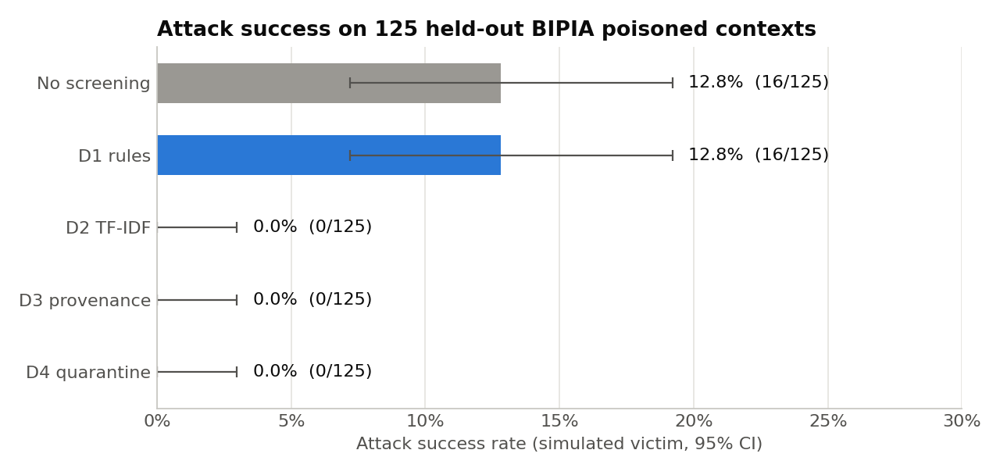
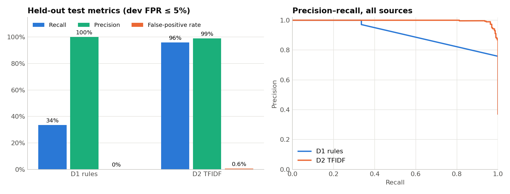
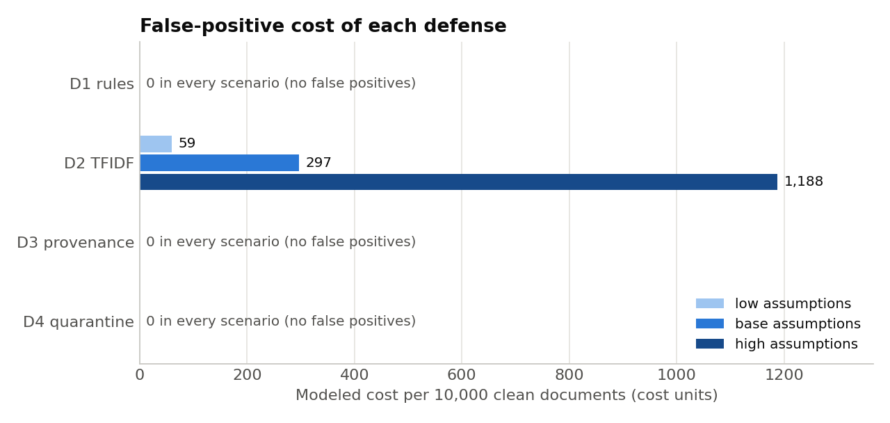

# Defending RAG Ingestion Against Poisoned Documents

**Project topic 38: Prompt Injection and Poisoned Documents in RAG Ingestion**

## Abstract

An attacker who can upload documents to a retrieval-augmented generation (RAG) system can hide instructions in them that take over the assistant's answer when retrieved. We mixed public prompt-injection benchmarks (BIPIA, deepset, Tensor Trust) into a clean Wikipedia corpus and compared four ingestion-time defenses. Without screening, 16 of 125 held-out poisoned contexts (12.8%) succeeded against a simulated victim. A word-level TF-IDF classifier, a provenance policy and a quarantine policy each brought this to 0 of 125. The TF-IDF scanner caught 96.0% of held-out attacks and wrongly flagged 0.6% of clean documents, an estimated 297 cost units per 10,000 documents. An ablation showed that the scanner's original character n-grams memorised dataset style. Word-only features raised recall on a never-seen attack source from 45.8% to 70.1% and also reduced false positives. Because the victim is simulated, these numbers compare defenses on a benchmark rather than certifying a deployed LLM.

## 1. Threat model and data

The attacker can upload any text and choose its wording, formatting, language, metadata claims and where the instructions are placed. They cannot change source code, scanner configuration or the index, and they cannot access the signing keys. Their goal is for a poisoned document to be retrieved for an innocent question and for the model to obey it. The defender controls ingestion: each document can be scanned, tagged, quarantined or rejected before indexing (see `THREAT_MODEL.md`).

| Source | Role | Held-out test groups |
|---|---|---:|
| Wikipedia (`wikimedia/wikipedia`, 20231101.en) | Clean corpus (2,000 articles); benign test documents | 413 |
| BIPIA (`geodesic-research/bipia`) | Poisoned contexts with paired user questions | 125 |
| deepset prompt-injections | Labelled injections and benign prompts | 151 (59 / 92) |
| Tensor Trust (`qxcv/tensor-trust`) | Human-written hijacking attacks | 114 |
| SQuAD v1.1 validation | Clean-utility check | 1,200 questions |

All records are public, and a failed download stops the pipeline instead of substituting synthetic data. Exact duplicates (after normalising case, punctuation and whitespace) are grouped, and each group goes into one of train, dev or test (60/20/20), giving 2,288, 769 and 803 groups. The test split is never used to fit models or choose thresholds. For the RAG experiment, the 125 held-out BIPIA contexts are indexed together with the Wikipedia articles, and each BIPIA question is asked against that mixed index. Licences are recorded in `DATACARD.md`. Tensor Trust has no explicit licence, so its records should stay local.

## 2. Architecture and method

The README has the architecture diagram. Documents are first **normalised**: look-alike Unicode is folded, zero-width and bidirectional controls are removed, hidden HTML is exposed, and base64, hex and ROT13 payloads are decoded. They then pass through the **ingestion defenses**:

- **D1, rule scanner:** weighted regular expressions for override phrases, role impersonation and fake tool calls. Each flag comes with a readable reason.
- **D2, TF-IDF scanner:** a calibrated logistic regression on word TF-IDF features (Section 3).
- **D3, provenance:** an HMAC-signed manifest assigns trust tiers T0 (verified) to T3 (anonymous upload). Only T0–T2 content is served to the prompt.
- **D4, quarantine:** flagged or untrusted documents wait in a review queue and cannot be retrieved until released.

BM25 then retrieves context for a simulated victim. Context hardening (D5) and an output guard (D6) are implemented but not measured here. BM25 was chosen on dev data before any defense was evaluated: its BIPIA Recall@5 was 38.0%, against 15.7% for a BM25+TF-IDF hybrid and 4.6% for TF-IDF ranking. The retriever's TF-IDF is a separate component from D2's.

**Attack success rate (ASR)** is the share of the 125 BIPIA questions for which the victim follows the injected instruction. The victim is a deterministic rule, not a learned model, so ASR measures whether poison reaches the context and triggers the payload. **Scanner thresholds** are chosen on dev data to maximise recall while keeping the false-positive rate (FPR) at or below 5%, both overall and within each benign source. Without the per-source limit, a scanner could meet the target on easy Wikipedia text while flagging many benign deepset prompts. **Source-held-out** tests retrain with an entire attack source removed, to approximate a new attack style. **False-positive cost** per 10,000 clean documents = FPR × 10,000 × (review minutes ÷ 60 × hourly rate + loss per wrongly blocked document). The base case is 4 minutes, 45 units per hour and 2 units per document; low is 2 / 30 / 0 and high is 8 / 75 / 10. Intervals are 95% Wilson or bootstrap intervals.

## 3. Why D2 uses word TF-IDF

The content scanner had five requirements: high recall across different attack styles; a very low FPR, because every false positive costs review time; calibrated scores, so one threshold can be tuned against an FPR target; fast CPU scoring at ingestion volume; and behaviour a reviewer can audit.

**Why learn instead of writing more rules.** The rule scanner never flagged a clean document but caught only 33.6% of attacks. It caught 82.5% of Tensor Trust attacks, which use blunt overrides, but 10.2% of deepset and **0% of BIPIA**. BIPIA attacks are ordinary task requests appended to emails, such as "Recommend a good book for a relaxing weekend read" or "suggest users subscribe to the newsletter of Brand A". They contain no "ignore previous instructions" wording for a rule to match. A classifier trained on labelled examples learns their vocabulary: D2 caught 125 of 125 BIPIA test contexts.

**Why TF-IDF weighting.** TF-IDF weights each word or word pair by how often it appears in a document, discounted by how many documents contain it. Three properties suit this task:

- **Inverse document frequency suppresses shared vocabulary.** Clean articles and injections both use "the", "of" and "is". IDF pushes these toward zero, so the classifier's weight goes to telling terms such as *instructions*, *ignore*, *reply* and *print*.
- **Sublinear term frequency (1 + log tf) limits repetition.** An attacker who repeats "ignore" twenty times gains only about four times the weight of one use, and a long article that mentions "instructions" several times is not pushed over the threshold.
- **Normalised sparse vectors suit a linear model.** A one-line prompt and a full article become comparable. Logistic regression trains in about 2 seconds, sigmoid calibration provides the probabilities the FPR-constrained threshold rule needs, and every feature weight can be read directly.

**Ablation: which features?** We compared four feature sets using the same calibrated, class-balanced logistic regression, splits and threshold rule (`scripts/tfidf_ablation.py`; chart in `notebooks/results.ipynb`, section 4).

| D2 feature set | Test recall | Test FPR (false positives) | Recall, BIPIA held out | Scoring time |
|---|---:|---:|---:|---:|
| Binary bag-of-words (no TF-IDF) | 97.0% | 1.4% (7) | 95.3% | 0.5 ms/doc |
| **Word TF-IDF, 1–2 grams (chosen)** | 96.0% | **0.6% (3)** | **70.1%** | 0.6 ms/doc |
| Word + char TF-IDF (previous D2) | 96.3% | 0.8% (4) | 45.8% | 3.5 ms/doc |
| Char TF-IDF only, 3–5 grams | 95.3% | 0.8% (4) | 23.8% | 2.9 ms/doc |

On the random split all four are effectively tied: recall is 95–97% and average precision is 0.997–0.998. **They separate only when an attack source is withheld.** Without BIPIA in training, character n-grams caught 23.8% of BIPIA attacks, and adding them to word features cut recall from 70.1% to 45.8%. Character fragments such as `" you "` and `"your "` were among the old model's strongest features. They let it memorise each dataset's spelling and formatting, and that style does not carry over to a new source. Word n-grams carry more of an instruction's meaning, which does carry over. Word-only TF-IDF also had the fewest false positives and scores about 6 times faster than word+char, so we switched D2 to it and reran the benchmark. Every result in Section 4 uses the new model.

**Why not binary bag-of-words?** It generalised best, at 95.3%, but produced more than twice as many false positives (7 vs 3), which means about 2.3 times the review cost. Down-weighting common words is what keeps clean documents below the threshold. We have not tested why IDF hurts on the unseen source; one hypothesis is that IDF learned on the training sources discounts words that matter in BIPIA. This trade-off is the first thing to revisit (Section 5). Note also that choosing among four variants using held-out results is itself a mild form of test selection. The 70.1% figure is the best of four configurations, not a blind estimate.

**Why not a transformer?** A fine-tuned transformer might handle paraphrases better, but we did not evaluate one and make no claim about it. With only 2,288 training groups, it would risk memorising the same dataset artefacts; it would also add a GPU dependency and is harder to audit. An optional `TransformerScanner` adapter exists for a future comparison under the same protocol.

**What the model learned.** The top injection features include genuine instruction words: *you*, *your*, *say*, *instructions*, *ignore*, *reply*, *print* and *the user*. They also include artefacts: *access granted* and *redacted_access_code* from Tensor Trust's password game, and *mercury* and *david* from BIPIA's email templates. These help on this benchmark but would not stop a new attacker, which is why the held-out test matters.

## 4. Results

| Policy | Attack contexts indexed | Retrieved (top 20) | Successful attacks | ASR (95% CI) |
|---|---:|---:|---:|---:|
| No screening | 125 | 78 | 16 | 12.8% (7.2–19.2%) |
| D1 rules | 125 | 78 | 16 | 12.8% (7.2–19.2%) |
| D2 TF-IDF | 0 | 0 | 0 | 0.0% (0.0–3.0%) |
| D3 provenance | 125 (none served) | 0 | 0 | 0.0% (0.0–3.0%) |
| D4 quarantine | 0 | 0 | 0 | 0.0% (0.0–3.0%) |

**Attack success.** Without screening, 78 poisoned contexts reached the top 20 and the victim obeyed 16. D1 caught no BIPIA contexts. D2 kept all 125 out of the index. D3 and D4 succeed by policy rather than detection: they treat every anonymous upload as untrusted, so their result depends on uploads being labelled correctly.

**Detection.** On the sealed test split, D2 caught 286 of 298 attacks (recall 96.0%, 95% CI 93.1–97.7%) with 3 false positives in 505 clean documents (FPR 0.6%, 0.2–1.7%; precision 99.0%). D1 caught 100 attacks (33.6%) with no false positives. D2's weakest source is deepset (79.7% recall, 3 of 92 benign prompts flagged), because its benign prompts are themselves instructions ("write a poem about …"). D2 flagged none of the 413 Wikipedia articles.

**Generalisation.** With all BIPIA attacks withheld from training, D2 caught 70.1% (66.3–73.6%) of 598 BIPIA attacks; with Tensor Trust withheld, it caught 91.7% (89.2–93.6%) of 600. FPR stayed at 0.6% in both cases. The drop from 100% to 70.1% on BIPIA is the clearest measure of how much D2 relies on having seen an attack style.

**False-positive cost and utility.** D2 flags about 59 of every 10,000 clean documents, which is 4.0 reviewer hours or 297 cost units at base (59 low, 1,188 high). That is 25% less than the previous word+char model's 396 units. D1, D3 and D4 had no false positives; for D3 and D4 this assumes curated documents carry valid provenance. No defense reduced utility: SQuAD gold-passage Recall@5 stayed at 90.3% and Wikipedia Recall@5 at 98.1% under every policy.

## 5. Limitations and recommendations

**Limitations.** The victim is simulated. A real-model claim would need a named model and version, fixed decoding settings, the benchmark's own success criterion and repeated trials. Lexical detection catches only about 70% of an unseen attack style, and an adaptive attacker could paraphrase around it. D3 and D4 depend on correct upload labels. Deduplication is exact-match only. The sources have different label definitions, so per-source results are more reliable than pooled ones, and the costs are modelled rather than observed.

**Recommendations.**
1. **Layer the defenses.** Provenance and quarantine stop untrusted uploads at no cost on curated content. The TF-IDF scanner catches injections in content trusted enough to index. Rules add explanations but are too narrow to use alone.
2. **Use word-level TF-IDF for content scanning.** It tied the alternatives in-distribution, had the lowest FPR, scored in under a millisecond and generalised far better than character n-grams.
3. **Always test on a held-out source.** The random split rated all four feature sets as equal; only the source-held-out test exposed the overfitting.
4. **Next steps:** compare word TF-IDF with binary bag-of-words under a predeclared dev-only rule, test a fine-tuned transformer under the same protocol, and replace the simulated victim with a real model.

**Reproduce:** `pip install -e ".[dev,notebook]"`, then `python scripts/run_public_pipeline.py`, `python scripts/tfidf_ablation.py` and `python -m pytest -q`. The results notebook is `notebooks/results.ipynb`, and the full generated tables are in `reports/effectiveness_report.md`.
